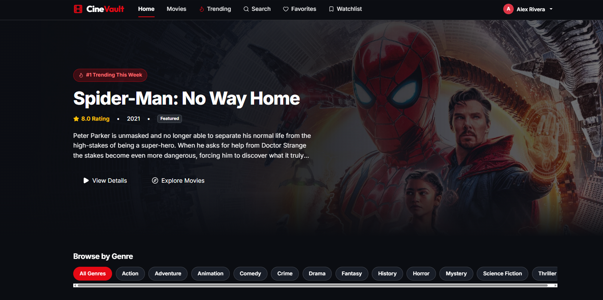

CineVault --- Movie Library App
A React-based movie library application inspired by the CineVault
design. Browse movies, explore trending titles, search for films, view
movie details, and save favorites or titles to a watchlist.
Features
- Home page: Featured movie banner and movie browsing experience.
- Movie library: Display movie posters and key information.
- Browse by genre: Filter movies by genre such as Action,
  Adventure, Comedy, Drama, Horror, and Science Fiction.
- Trending movies: Discover popular and trending titles.
- Search: Search movies by title and update results as the user
  types.
- Movie details: Show a selected movie's poster, title, rating,
  release date, genre, language, and description.
- Favorites: Save and manage favorite movies.
- Watchlist: Add movies to a personal watchlist.
- User authentication: Provide a simple sign-in experience and
  save user preferences.
- Loading and error states: Display loading indicators and
  friendly messages when movie data cannot be loaded.
- Responsive UI: Use a clean layout that works across desktop and
  smaller screens.
Technology Stack
- React
- React Router DOM
- Redux / React Redux
- Redux Thunk (if asynchronous Redux actions are used)
- Bootstrap and/or custom CSS
- A movie API such as The Movie Database (TMDB)
Getting Started
1. Requirements
Install Node.js and npm before starting.
2. Create or open the project
If creating the project from scratch:
npx create-react-app cinevault
cd cinevault
Or open the existing project folder in VS Code.
3. Install dependencies
npm install
npm install react-router-dom redux react-redux redux-thunk bootstrap
Install any additional dependencies required by the existing code.
4. Configure the movie API
1. Create an account with your chosen movie API provider.
2. Generate an API key.
3. Store the key in an environment file such as .env using the
   variable name expected by your code.
4. Do not commit secret API keys to a public repository.
Example for a Create React App project:
REACT_APP_TMDB_API_KEY=your_api_key_here
5. Start the app
npm start
The development server will display the local URL in the terminal,
usually http://localhost:3000.
Suggested Project Structure
cinevault/
├── public/
├── src/
│   ├── components/
│   │   ├── Navbar.jsx
│   │   ├── MovieList.jsx
│   │   ├── MovieCard.jsx
│   │   ├── MovieDetails.jsx
│   │   ├── MovieSearch.jsx
│   │   ├── GenreFilter.jsx
│   │   ├── Favorites.jsx
│   │   ├── Watchlist.jsx
│   │   └── Loader.jsx
│   ├── pages/
│   │   ├── Home.jsx
│   │   ├── Movies.jsx
│   │   ├── Trending.jsx
│   │   └── Login.jsx
│   ├── redux/
│   │   ├── actions.js
│   │   ├── reducer.js
│   │   └── store.js
│   ├── services/
│   │   └── movieApi.js
│   ├── App.js
│   ├── index.js
│   └── index.css
├── .env
├── .gitignore
├── package.json
└── README.md
This is a suggested structure; adapt filenames and folders to match your
actual project.
Main Implementation Tasks
1. Project setup: Create the React project and install the required
   packages.
2. Component structure: Build reusable components for the navbar,
   movie list, movie details, search, favorites, and watchlist.
3. Redux setup: Create the store, reducers, and actions for movie
   data, loading, errors, favorites, and watchlist state.
4. Movie API integration: Fetch popular movies, trending movies,
   movie details, and search results from the selected API.
5. Display movie data: Render movie cards dynamically from API
   responses.
6. Search and genre filters: Update the displayed movie list based
   on the search text and selected genre.
7. Movie details: Show detailed information for the selected movie.
8. Loading and error handling: Handle pending requests, empty
   results, and API failures.
9. Authentication and preferences: Add a simple sign-in flow and
   persist favorites/watchlist where appropriate.
10. Navigation: Use React Router DOM to move between Home, Movies,
    Trending, Search, Favorites, and Watchlist.
11. Styling: Use Bootstrap and custom CSS to create a consistent
    dark theme with red accents.
12. Testing: Verify navigation, API calls, search, filters,
    favorites, watchlist, and responsive behavior.
Notes
- API response fields and image URLs depend on the provider you
  choose.
- For TMDB, use its official documentation to configure API requests
  and image paths.
- A frontend-only sign-in flow is for demonstration purposes;
  production authentication should use a secure backend or trusted
  authentication provider.
- Actual scripts may differ by project setup. Check package.json if
  npm start is unavailable.

## Screenshots

"# moviesReact" 
